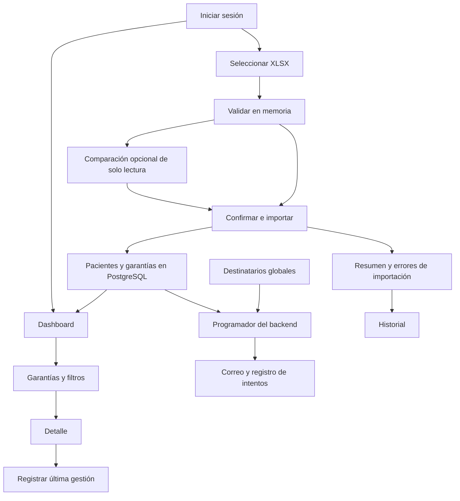

# Análisis funcional integral del proyecto original «Monitor de Garantías GES»

Fecha de revisión: **3 de noviembre de 2026**, referencia horaria `America/Santiago`.

Proyecto revisado: `C:\proyectos\Monitor de Garantías GES`.

## 1. Alcance y fundamento del informe

Este documento describe el funcionamiento implementado en el proyecto original: qué puede hacer cada usuario, qué ejecuta la aplicación al operar sus pantallas, qué reglas aplica y qué información conserva PostgreSQL. No contiene una comparación con MonitorGES2 ni propone o implementa funcionalidades.

El módulo de áreas de responsabilidad queda excluido de este informe, ya que se rediseñará más adelante. Los inventarios funcionales, de rutas y de persistencia se limitan al alcance restante.

Se revisaron la navegación activa, componentes de pantalla, servicios HTTP, rutas y permisos del backend, consultas y escrituras Prisma/SQL, procesamiento de Excel, correo, esquema y migraciones. Se ejecutaron pruebas existentes, compilación del frontend y chequeo de tipos del backend. Además se consultó la base configurada localmente mediante transacciones SQL de solo lectura, sin extraer registros personales ni credenciales.

**La referencia es el contenido actual del workspace, incluidos sus cambios locales sin confirmar en Git.** No equivale necesariamente al último commit, a una versión publicada ni al código cargado por algún proceso que estuviera ejecutándose antes de esta revisión.

Se distinguen tres tipos de evidencia:

| Evidencia | Qué permite afirmar | Límite |
| --- | --- | --- |
| Código conectado a la navegación/API | Comportamiento implementado y recorrido de los datos | No prueba por sí solo que un despliegue esté ejecutando esa versión |
| Pruebas existentes y compilación | Comportamientos cubiertos y viabilidad de compilación | Muchas pruebas usan dobles en memoria; algunas comprueban texto del código |
| Consultas PostgreSQL de solo lectura | Existencia de tablas, columnas, migraciones registradas y cantidades de datos en la base local | Es una instantánea; no certifica otros ambientes ni entrega real de correos |

No se ejecutaron importaciones reales, registros de gestión, cambios de usuarios, migraciones, seed, envíos SMTP ni reinicios del servidor. No se realizó un recorrido completo con un navegador autenticado.

## 2. Qué trabajo permite realizar hoy

La aplicación es un monitor operacional de garantías alimentado por nóminas Excel. El flujo principal es:

1. Un funcionario autorizado inicia sesión con usuario y contraseña.
2. Consulta el dashboard para conocer la distribución por plazos y acceder a garantías urgentes.
3. Busca garantías por paciente, estado, responsable, problema de salud o nombre de garantía.
4. Abre una garantía para revisar sus datos y, si su perfil lo permite, registrar que realizó una gestión.
5. Si tiene permiso de carga, selecciona una nómina XLSX, la valida, opcionalmente la compara con los registros existentes y confirma la importación.
6. La importación agrega garantías, actualiza algunos campos de coincidencias existentes y conserva un resumen con errores y cantidades.
7. Consulta el historial de importaciones para revisar resultados globales.
8. ADMIN administra cuentas y destinatarios del correo.
9. Independientemente de la navegación, un backend con la automatización habilitada puede enviar un informe diario por correo.

**El ciclo implementado es importar, observar, priorizar y dejar constancia de la última gestión.** No existe un ciclo de resolución clínica con estados de cumplimiento, cierre, reapertura o una bitácora de actuaciones.

La comparación previa no condiciona el algoritmo definitivo de importación.

Fuentes: [App](src/App.tsx), [pantallas principales](src/pages/pages1.tsx), [garantías y detalle](src/pages/GuaranteesPage.tsx), [importación, historial y alertas](src/pages/pages2.tsx).

## 3. Usuarios, permisos y alcance de los datos

Los permisos efectivos se verifican en el servidor. Ocultar botones en React no es el único control de acceso.

| Operación | ADMIN | COORDINADOR_SOME | PROFESIONAL | LECTOR |
| --- | --- | --- | --- | --- |
| Consultar dashboard, garantías y detalle | Sí | Sí | Sí | Sí |
| Consultar historial de importaciones | Sí | Sí | Sí | Sí |
| Consultar destinatarios del correo | Sí | Sí | Sí | Sí |
| Validar, comparar e importar nóminas | Sí, por perfil | Solo con `puedeCargarNominas=true` | Solo con `puedeCargarNominas=true` | No |
| Registrar gestión de una garantía | Sí | No | Sí | No |
| Administrar cuentas y contraseñas | Sí | No | No | No |
| Modificar destinatarios globales | Sí | No | No | No |

El permiso de cargar nóminas es independiente del permiso de registrar gestiones. Por ejemplo, un profesional sin permiso de carga sí puede registrar una gestión; un coordinador autorizado a cargar no puede registrar gestiones.

ADMIN puede importar aunque su campo `puedeCargarNominas` sea `false`. LECTOR nunca puede importar: la API rechaza asignarle ese permiso. El control administrativo normal impide guardar lectores con el permiso activo.

**Las lecturas son globales.** Las consultas de garantías, dashboard e historial no filtran por usuario ni establecimiento.

Fuentes: [permisos de autenticación](backend/src/modules/auth/routes.ts), [rutas de garantías](backend/src/modules/garantias/routes.ts), [usuarios](backend/src/modules/usuarios/routes.ts).

## 4. Inicio de sesión, continuidad y salida

### 4.1 Entrada del usuario

Al abrir la aplicación, React consulta `GET /api/auth/me`. Mientras espera muestra «Verificando sesión…». Si obtiene identidad muestra la aplicación; si la petición falla muestra el login. Un fallo de disponibilidad del servidor también puede conducir al login, porque el cliente trata cualquier error inicial como ausencia de usuario.

El formulario solicita usuario y contraseña. `POST /api/auth/login` consulta una cuenta por `username`, exige que esté activa y verifica su contraseña mediante scrypt. El nombre de usuario se recorta, pero la búsqueda no lo convierte a minúsculas: el código no implementa un login explícitamente indiferente a mayúsculas.

No hay inscripción pública, login institucional SSO ni recuperación de contraseña por correo. La denominación «cuenta institucional» es el texto de la pantalla; la autenticación implementada es propia de esta aplicación.

### 4.2 Qué se guarda

Un login correcto crea una fila en `SesionUsuario` con el usuario, expiración de ocho horas y hash SHA-256 de un token aleatorio. El navegador recibe el token mediante cookie `ges_session`, `HttpOnly`, `SameSite=Strict`, con ruta `/api`; agrega `Secure` en producción. La contraseña se almacena derivada con scrypt y sal, no en texto plano.

Crear una sesión también elimina sesiones vencidas. Las peticiones privadas vuelven a leer la sesión y la cuenta en PostgreSQL; rechazan sesiones vencidas o usuarios inactivos. No hay renovación deslizante de las ocho horas.

Las credenciales incorrectas, cuentas inexistentes o inactivas producen un error genérico. El limitador en memoria usa una ventana de 15 minutos y umbrales de cinco fallos por usuario/IP y 30 por IP. No es un registro persistido ni compartido entre procesos. El código también purga el estado al terminar la ventana desde su inicio, de modo que el mensaje de «espera 15 minutos» no debe interpretarse como un temporizador exacto desde el último fallo.

### 4.3 Salida y cambios de permisos

«Cerrar sesión» llama a `POST /api/auth/logout`, elimina la sesión actual y limpia la cookie. Si falla, la interfaz conserva al usuario y muestra un error. Desactivar una cuenta o cambiar su contraseña desde administración revoca sus sesiones.

Los cambios de rol o permiso se reflejan en el backend en la siguiente petición, ya que se lee la cuenta nuevamente. La identidad de React se conserva en memoria y no se refresca automáticamente; los menús pueden seguir mostrando los permisos previos hasta volver a cargar o iniciar sesión.

El cliente HTTP muestra errores de las peticiones, pero no implementa una redirección global al login al recibir cualquier `401` durante el uso de la aplicación.

**El campo «Último acceso» no se actualiza al iniciar sesión.** Existe en el modelo y se muestra en administración, pero no se encontró una escritura de `ultimoAccesoAt` en el flujo de autenticación actual. Un valor vacío se muestra como «Nunca» y no demuestra ausencia de logins.

Fuentes: [servicio de autenticación](backend/src/modules/auth/auth-service.ts), [rutas y cookie](backend/src/modules/auth/routes.ts), [cliente HTTP](src/services/api.ts), [App](src/App.tsx).

## 5. Dashboard: panorama y priorización

El dashboard ejecuta `GET /api/dashboard`. El backend cuenta las garantías de PostgreSQL según su fecha límite y la fecha civil actual; devuelve también la última importación y hasta ocho garantías urgentes.

| Elemento visible | Funcionamiento real | Efecto sobre los datos |
| --- | --- | --- |
| Tarjetas Normal, Atención, Próxima, Crítica y Vencida | Conteos de todas las garantías por rango de días | Lectura |
| Clic en una tarjeta | Abre Garantías con ese estado preseleccionado | Cambia navegación y filtros en memoria |
| «Requieren atención» | Hasta ocho garantías vencidas o con límite dentro de siete días, ordenadas por fecha límite ascendente | Lectura |
| «Ver todas» | Abre Garantías con estados vencida y crítica | Sin escritura |
| Clic en una fila | Abre su detalle por UUID | Lectura |
| Última actualización de nómina | Fecha de la importación más reciente registrada, cualquiera sea su estado | No verifica que haya cambiado una garantía |
| «Importar nómina» | Abre la pantalla de carga | La API exige permiso al validar/importar |

La selección de ocho urgentes usa fecha límite ascendente. Por tanto, vencidas antiguas pueden ocupar toda la tabla y dejar críticas próximas fuera de esas ocho filas; no es la misma prioridad que usa el informe por correo.

La fecha rotulada como «Última actualización de nómina» también puede corresponder a una importación fallida o sin cambios, porque la consulta no filtra por éxito ni por registros modificados.

El botón de importar del dashboard se muestra a todos los perfiles, aunque el menú lateral lo oculta según permisos. Un usuario sin permiso puede llegar a esa pantalla por el botón; las operaciones de la API serán rechazadas con `403`.

No hay actualización continua ni refresco programado del dashboard. Consulta al montar la pantalla; navegar nuevamente lo vuelve a cargar. Ante error muestra el fallo y no reemplaza los datos con garantías ficticias.

Fuentes: [Dashboard](src/pages/pages1.tsx), [repositorio del dashboard](backend/src/modules/dashboard/repository.ts), [servicio del dashboard](backend/src/modules/dashboard/service.ts).

## 6. Garantías: buscar, filtrar y consultar

La pantalla consulta `GET /api/garantias` con paginación del servidor de **12 filas por página**. Muestra estado, RUT, paciente, problema, garantía, inicio, fecha límite, días restantes, responsable y acceso al detalle. Si existe una fecha de gestión agrega la marca «Gestión registrada».

### 6.1 Búsqueda y filtros

| Control | Regla aplicada |
| --- | --- |
| Búsqueda general que empieza con un dígito | Se envía como búsqueda de RUT |
| Búsqueda general que no empieza con un dígito | Se envía como búsqueda parcial por nombre, sin distinguir mayúsculas |
| RUT sin DV separado por guion | Búsqueda parcial en el número, retirando puntos y caracteres no numéricos |
| RUT con guion y DV | Número y DV exactos; DV sin distinguir mayúsculas |
| Estado | Uno o varios rangos de fecha límite |
| Responsable | Igualdad exacta del texto, sin distinguir mayúsculas |
| Problema de salud | Igualdad exacta del texto, sin distinguir mayúsculas |
| Nombre de garantía | Igualdad exacta del texto, sin distinguir mayúsculas |
| Orden de «Días restantes» | Alterna orden ascendente/descendente por fecha límite |
| «Limpiar» | Vacía búsqueda y filtros textuales; restaura los cuatro estados no vencidos |

Las opciones de los tres selectores textuales se obtienen de las garantías existentes mediante `GET /api/garantias/opciones-filtros`; se deduplican sin distinguir mayúsculas. No son opciones encadenadas que se recalculen con los otros filtros.

Los filtros se combinan; los estados seleccionados se unen entre sí como alternativas. Cambiar filtros restablece la primera página. La búsqueda se consulta mientras se escribe, sin un botón «Buscar» ni espera de debounce; las solicitudes anteriores se abortan al cambiar parámetros.

**Al entrar normalmente se excluyen las vencidas.** Están seleccionadas normal, atención, próxima y crítica. Si se desmarcan todos los chips, el cliente omite el filtro de estado y la API devuelve todos los estados; no devuelve una lista vacía.

Los filtros y la página viven en el estado React. Volver desde el detalle navega a un listado nuevo y no recupera automáticamente la búsqueda, página y selección anteriores. La navegación no está modelada como rutas con parámetros persistidos en la URL.

### 6.2 Capacidades de API que no tienen control visible

La API admite además fecha límite desde/hasta, límites de 1 a 100 y orden por fecha de inicio, nombre de garantía, responsable o creación. La pantalla actual envía un tamaño fijo de 12 y orden por fecha límite; no expone controles para esas otras variantes.

Consultar, filtrar y ordenar no modifica pacientes ni garantías. Los estados y días se calculan al responder; no se guardan como actualizaciones por cada búsqueda.

Fuentes: [Garantías](src/pages/GuaranteesPage.tsx), [servicio cliente](src/services/garantias.ts), [validación de consultas](backend/src/modules/garantias/schema.ts), [repositorio de garantías](backend/src/modules/garantias/repository.ts).

## 7. Detalle y registro de gestión

`GET /api/garantias/:id` devuelve la garantía, su paciente, fechas, días, estado, responsable y última gestión. El backend valida UUID y diferencia identificador inválido (`400`) de garantía inexistente (`404`).

ADMIN y PROFESIONAL ven «Registrar gestión» o «Registrar nueva gestión». La acción no solicita observación, resultado, fecha manual ni documento adjunto. Ejecuta `POST /api/garantias/:id/gestion`.

El servidor toma al funcionario de la sesión y la fecha del servidor. Un `UPDATE` SQL modifica exclusivamente:

- `Garantia.gestionadaAt`.
- `Garantia.gestionadaPorUsuarioId`.

La interfaz muestra la fecha en horario de Santiago y el nombre del funcionario devuelto por la API. Bloquea nuevos clics mientras espera y muestra éxito solo tras la respuesta satisfactoria.

**Cada registro reemplaza la última gestión anterior.** No hay tabla de eventos de gestión, historial de actuaciones, comentarios ni evidencia de lo que se hizo. Dos usuarios que registren sucesivamente dejan la última escritura como dato vigente.

Registrar gestión no cambia `responsable`, `fechaLimite`, `version` ni `updatedAt`; tampoco modifica el estado por plazo. La garantía sigue apareciendo en conteos, filtros de urgencia y correos si su fecha corresponde. No significa cumplimiento ni cierre.

Las importaciones posteriores preservan estos campos de gestión cuando actualizan fecha límite o responsable del registro coincidente.

Fuentes: [Detalle](src/pages/GuaranteesPage.tsx), [controlador de gestión](backend/src/modules/garantias/controller.ts), [escritura de gestión](backend/src/modules/garantias/repository.ts).

## 8. Reglas de plazo, estado e identidad

### 8.1 Estado operacional por vencimiento

La fuente de verdad es `fechaLimite`. El backend calcula la diferencia entre fechas civiles, por defecto en `America/Santiago`, sin depender de la columna de días del Excel.

| Días restantes | Estado |
| --- | --- |
| Menos de 0 | Vencida |
| 0 a 7, incluidos | Crítica |
| 8 a 15, incluidos | Próxima a vencer |
| 16 a 30, incluidos | Atención |
| 31 o más | Normal |

Una garantía que vence hoy es crítica con cero días restantes. Puede pasar de normal a atención o de crítica a vencida por el transcurso del tiempo, sin una nueva importación ni escritura en PostgreSQL. Una pantalla abierta conserva su respuesta hasta volver a consultar.

Las fechas de inicio y límite son columnas SQL `DATE`, sin hora y obligatorias. Los rangos son reglas operacionales implementadas; no se verificó su correspondencia con normativa sanitaria externa. No hay pantalla ni tabla de configuración de estos umbrales. El parámetro opcional de configuración de la función de estado no está conectado a una configuración editable por usuarios.

El dashboard y las consultas usan `TIME_ZONE` con valor predeterminado Santiago. El programador del correo fija expresamente `America/Santiago`; cambiar `TIME_ZONE` a otra zona podría hacer divergir la fecha de referencia entre ambos. En el `.env` local revisado se usa Santiago.

Existe un `TODAY` fijo de octubre en los datos auxiliares del frontend, pero las pantallas operativas reciben sus días y estados del backend; ese valor no gobierna las garantías persistidas.

### 8.2 Identificación del paciente y la garantía

El paciente se identifica mediante `rutNumero + dv`, combinación única en PostgreSQL. El importador limpia separadores del RUT y pone el DV en mayúsculas. No hay un identificador de episodio proveniente del sistema de origen.

La coincidencia provisional de una garantía en la importación definitiva es:

`RUT + DV + problema de salud normalizado + nombre de garantía normalizado + fecha de inicio`.

Los textos se normalizan retirando tildes, convirtiendo a minúsculas y uniformando espacios y separadores. Fecha límite, responsable y días restantes no forman parte de esa identidad.

No hay una restricción única de base de datos sobre esa combinación de garantía. El importador usa un bloqueo transaccional de PostgreSQL para la clave provisional y revisa si existen varios candidatos. Esta regla no demuestra identidad clínica: dos episodios distintos con esos mismos campos pueden resultar indistinguibles.

El `responsable` de una garantía es **texto importado**, sin relación con `Usuario`. La persona que registra una gestión es otro dato, guardado como referencia al usuario.

Fuentes: [estados](backend/src/modules/garantias/status.ts), [fechas](backend/src/utils/dates.ts), [normalización](backend/src/modules/importaciones/identity-normalization.ts), [importador](backend/src/modules/importaciones/import-service.ts), [esquema](backend/prisma/schema.prisma).

## 9. Importar una nómina: recorrido completo

### 9.1 Seleccionar y validar

El usuario arrastra o selecciona un archivo `.xlsx` de hasta 10 MB. El frontend comprueba extensión y tamaño; el servidor vuelve a comprobarlos, exige un archivo en el campo multipart `archivo` y verifica que el contenido pueda leerse como XLSX.

Solo se procesa **la primera hoja**. Se busca la fila de encabezados entre las primeras 30 filas; puede haber títulos antes. Los encabezados se comparan sin tildes, diferencias de mayúsculas ni separadores equivalentes. El orden de columnas puede variar, pero deben reconocerse los nueve encabezados:

1. Problema de salud.
2. RUT.
3. DV.
4. Nombre.
5. Fecha de inicio.
6. Fecha límite.
7. Días que faltan para el vencimiento de la garantía.
8. Nombre de la garantía.
9. Responsable de la garantía.

`POST /api/importaciones/validar` examina las filas en memoria y devuelve cantidades, errores por número de fila y hasta diez referencias de filas válidas. La respuesta de validación no expone nombre, RUT ni problema clínico de esas filas. La interfaz muestra una indicación de disponibilidad, no una tabla con sus datos personales.

Validar no crea `Importacion`, `Paciente`, `Garantia` ni `ErrorImportacion`. Cancelar o cambiar el archivo descarta ese estado de pantalla. El archivo original no se almacena permanentemente.

### 9.2 Validaciones de fila

| Aspecto | Regla efectiva |
| --- | --- |
| Textos requeridos | Problema, RUT, DV, nombre, nombre de garantía y responsable no pueden estar vacíos |
| RUT | Número de 1 a 8 dígitos y DV válido por módulo 11; acepta normalización de formato compuesto |
| DV | Número o K; se comprueba concordancia cuando viene también en el RUT compuesto |
| Días del Excel | Campo obligatorio y entero, aunque después no se usa para calcular ni persistir el estado |
| Fechas | Acepta fechas Excel, seriales de Excel y formatos textuales año-mes-día o día/mes/año con separadores admitidos |
| Orden de fechas | Fecha límite no anterior a fecha de inicio |
| Filas vacías después del encabezado | Se cuentan como leídas y erróneas, no se omiten silenciosamente |
| Archivo sin datos | Se rechaza antes de crear una importación |

Las fórmulas se leen mediante su resultado guardado cuando está disponible; el backend no es un motor de recálculo de Excel.

Una fila puede producir varios mensajes de error; `filasConErrores` y `registrosConError` cuentan filas, no mensajes. No se comprueba que los días informados coincidan con la fecha límite. La carga trabaja con textos para problema, garantía y responsable.

### 9.3 Comparación opcional con garantías actuales

Después de validar se puede ejecutar `POST /api/importaciones/comparar`. Relee el archivo, consulta garantías de los RUT presentes y clasifica las filas válidas. No escribe en la base ni reserva cambios.

La comparación tiene un límite de 5.000 filas posteriores al encabezado; este límite adicional no existe en el validador normal ni en el importador definitivo.

Para clasificar usa una «familia»: mismo paciente, problema y nombre de garantía normalizados, sin fecha de inicio. Aplica las reglas en este orden:

| Clasificación | Cuándo se devuelve |
| --- | --- |
| `DUDOSA_REPETIDA_EN_ARCHIVO` | La misma familia aparece más de una vez entre las filas válidas del archivo, incluso con distintas fechas de inicio |
| `DUDOSA_VARIOS_CANDIDATOS` | Hay más de una garantía existente de esa familia, incluso si solo una coincide en fecha de inicio |
| `COINCIDENCIA_EXACTA_UNICA` | Hay un único candidato de la familia y coincide la fecha de inicio |
| `DUDOSA_FECHA_DISTINTA` | Hay un candidato de la familia y su fecha de inicio es distinta |
| `NUEVA_PROPUESTA` | No hay candidatos de esa familia entre los registros consultados |

Solo para una coincidencia exacta única se señalan diferencias de fecha límite y responsable informado. Esas diferencias no cambian la clasificación. La API devuelve números de fila, clasificación, cantidad de candidatos y nombres de campos diferentes; no devuelve los RUT, nombres o valores clínicos de los candidatos.

El usuario no puede resolver dudas, elegir un candidato ni aprobar cambios individualmente. La pantalla protege la comparación frente a respuestas antiguas al cambiar de archivo, pero no congela la base entre comparar e importar.

**La comparación es informativa y no es una simulación contractual del importador definitivo.** Este último no consume sus clasificaciones.

### 9.4 Confirmación y escrituras reales

«Confirmar e importar» vuelve a enviar el archivo a `POST /api/importaciones`. El servidor vuelve a validarlo e identifica al importador mediante su sesión. No depende de que se hayan ejecutado antes las rutas de validar o comparar.

Primero crea una fila `Importacion` con nombre de archivo saneado, usuario, fecha, filas leídas y errores iniciales. La crea inicialmente como `FALLIDA`; no existe un estado de importación «en proceso».

Después procesa secuencialmente cada fila válida, con una transacción independiente por fila:

| Situación encontrada | Qué ocurre en PostgreSQL |
| --- | --- |
| Más de una garantía con la clave provisional completa | Registra `AMBIGUOUS_MATCH`, incrementa errores y omite la fila, sin modificar esos candidatos |
| Paciente inexistente | Crea `Paciente` |
| Paciente existente y nombre distinto | Actualiza su nombre; afecta las consultas de todas las garantías de ese paciente |
| Ninguna coincidencia de garantía con la clave completa | Crea `Garantia`, con versión inicial 1 |
| Una coincidencia y cambió fecha límite o responsable | Actualiza únicamente esos campos fuente que cambiaron e incrementa `version` |
| Una coincidencia, sin cambios en garantía, pero cambió el nombre del paciente | Cuenta la fila como actualizada; no incrementa la versión de la garantía |
| Una coincidencia sin cambios | Incrementa el contador de filas sin cambios |
| Fallo de base de datos al procesar una fila | Revierte esa transacción de fila, intenta registrar `DATABASE_ERROR` y continúa con las restantes |

Cuando la coincidencia se determina por textos normalizados, no se reescriben problema o nombre de garantía solo por cambios de tildes, mayúsculas o formato. No se borra la gestión anterior.

Al terminar se guarda el estado final:

- `COMPLETADA`: ninguna fila con error.
- `COMPLETADA_CON_OBSERVACIONES`: hay filas con error y al menos una procesada correctamente; una fila sin cambios también cuenta como procesada.
- `FALLIDA`: hubo errores y ninguna fila procesada correctamente.

Las cantidades se refieren al procesamiento de filas; no necesariamente a garantías distintas. Repetir el mismo archivo crea otra fila de historial aunque todas sus garantías queden sin cambios. No hay huella de archivo ni clave de idempotencia para la solicitud completa.

La interfaz evita el doble clic durante una importación, pero una nueva solicitud posterior puede volver a procesar el archivo. Si se pierde la respuesta HTTP después de escrituras exitosas, el usuario no puede asumir que no se guardó nada.

### 9.5 Diferencias verificadas entre comparación y aplicación

| Caso | Comparación previa | Importación definitiva |
| --- | --- | --- |
| Mismo paciente/problema/garantía, nueva fecha de inicio y un candidato previo | Dudosa por fecha distinta | Puede crear otra garantía, porque la fecha integra su clave |
| Varias garantías de la familia, solo una con esa fecha de inicio | Dudosa por varios candidatos | Puede actualizar la única coincidencia de la clave completa |
| Familia repetida dentro del archivo | Marca las filas como dudosas | Las procesa en orden; puede insertar primero y actualizar la misma garantía después, o crear garantías de fechas distintas |
| Varios candidatos con la misma clave completa | Dudosa | Omite por `AMBIGUOUS_MATCH` |

Por ello, el aviso de pantalla que dice que las «coincidencias ambiguas» no se aplicarán solo describe fielmente las ambigüedades que detecta el importador, no todas las categorías dudosas de la vista previa.

### 9.6 Alcance de la actualización de nóminas

La importación es acumulativa. Si una garantía existente no aparece en una nómina posterior, permanece almacenada y sigue participando en el monitor y los correos. No se cierra, desactiva ni elimina por ausencia.

No hay transacción global que revierta toda la nómina. Si ocurre un fallo fatal después de procesar varias filas, las filas ya confirmadas pueden permanecer guardadas aunque el cliente reciba error o el resumen no alcance su estado final. La condición inicial `FALLIDA` tampoco certifica por sí sola que una ejecución interrumpida no haya escrito datos.

No se conserva el XLSX ni una copia histórica por fila aplicada. `ErrorImportacion.datosFila` existe en el esquema, pero este importador no lo rellena. Tampoco se guarda una relación de cada garantía con la importación que la creó o modificó.

Fuentes: [pantalla de importación](src/pages/pages2.tsx), [rutas](backend/src/modules/importaciones/routes.ts), [validador](backend/src/modules/importaciones/validation-service.ts), [comparación](backend/src/modules/importaciones/comparison-preview-service.ts), [clasificador](backend/src/modules/importaciones/row-matching.ts), [importador persistente](backend/src/modules/importaciones/import-service.ts).

## 10. Historial de importaciones

La pantalla consulta `GET /api/importaciones?page=…&limit=25`, ordenado desde la importación más reciente. Muestra fecha, funcionario, archivo, cantidades y estado. «Ver detalle» abre un modal con la fila que ya estaba cargada; no consulta un detalle adicional.

El modal incluye nuevos, actualizados, sin cambios, errores y estado. No presenta errores individuales ni permite descargar el archivo o revertir la importación. Aunque los errores estén persistidos, no existe una ruta de consulta de detalle/errores conectada a esta pantalla.

**Hay una discrepancia en el total de filas leídas:** el repositorio devuelve `registrosLeidos`; la interfaz y su tipo esperan `filasLeidas`, y el servicio cliente no transforma el nombre. En el estado actual del código, la columna «Registros» y el campo «Filas leídas» del modal pueden quedar vacíos. El número sí existe en PostgreSQL. La respuesta inmediata de confirmar una importación sí usa `filasLeidas`, por lo que el resultado final del asistente no presenta este mismo desacople.

El historial conserva un resumen de cada ejecución, no una trazabilidad de cambios por garantía. No permite reconstruir desde la aplicación qué valor anterior fue reemplazado ni qué filas exactas se aplicaron correctamente.

Fuentes: [Historial](src/pages/pages2.tsx), [servicio cliente de importaciones](src/services/importaciones.ts), [repositorio del historial](backend/src/modules/importaciones/repository.ts).

## 11. Alertas y correo

### 11.1 Lo que hace la pantalla Alertas

La pantalla activa es una administración de **destinatarios globales del informe diario**. Consulta `GET /api/notificaciones/configuracion-correo`. Todos los perfiles autenticados pueden leer; ADMIN puede agregar, quitar y guardar direcciones con `PUT`.

Se recortan las direcciones, se pasan a minúsculas y se deduplican. La API admite hasta 50 elementos antes de deduplicar. Una lista vacía permite pausar futuros envíos que dependan de esa lista; para guardarla desde la pantalla se deben quitar todas las filas. Dejar una fila vacía genera una validación local.

Se guarda una sola configuración con ID `global` en `ConfiguracionNotificaciones`. Se conserva también el campo legado escalar con el primer correo, o nulo si la lista está vacía. Guardar destinatarios **no envía un correo**.

No existe bandeja de notificaciones, marcar como leído, alertas individuales por usuario ni historial de envíos en esa pantalla. Aunque la API informa `automaticEnabled` y `scheduledTime`, la pantalla no los usa para mostrar el estado operacional ni permite cambiarlos.

### 11.2 Qué envía realmente el informe

El backend selecciona todas las garantías cuya fecha límite es menor o igual a hoy más 30 días: incluye todas las vencidas, sin límite de antigüedad, y excluye las normales. No excluye garantías con gestión registrada.

El mensaje incluye versiones de texto y HTML. Las columnas efectivas son estado, **RUT**, tipo/nombre de garantía, fecha límite, días restantes o vencidos y responsable. No incluye el nombre del paciente ni el campo problema de salud.

**La pantalla y parte del README afirman que el correo no incluye RUT, pero el código actual sí lo incorpora expresamente.** Esta afirmación se verificó en la consulta y en ambos formateadores; no fue necesario enviar ningún correo.

El orden es críticas, próximas, atención y vencidas al final; dentro de cada estado, fecha límite y luego ID. Puede enviarse un informe vacío con un mensaje de ausencia de garantías elegibles.

Es un solo mensaje dirigido al conjunto global de destinatarios mediante `to`, sin segmentación por funcionario. Las direcciones se incluyen en el campo de destinatarios del mensaje.

### 11.3 Programación y condiciones de ejecución

El programador se inicia desde `backend/src/server.ts`, no desde React. Su activación depende de `AUTO_EMAIL_ENABLED` y su hora de `AUTO_EMAIL_TIME`, con valores predeterminados `false` y `08:00`. Usa expresamente la zona `America/Santiago`.

Comprueba la hora aproximadamente cada 30 segundos. Requiere backend activo, conexión a PostgreSQL, configuración SMTP y destinatarios válidos. No depende de que un usuario mantenga una pantalla abierta.

Si arranca antes de la hora prevista, puede crear la reserva diaria al llegar la hora. Si arranca en un minuto posterior al programado, solo intenta continuar una reserva que ya exista para ese día: sin reserva, o si no puede comprobarla, omite crear un informe nuevo ese día. Arrancar dentro del mismo minuto programado no entra en esa exclusión.

En el `.env` local revisado se encontró `AUTO_EMAIL_ENABLED=true`, `AUTO_EMAIL_TIME=08:00` y `TIME_ZONE=America/Santiago`. Esto acredita la configuración disponible para un arranque que la cargue, no el estado de un proceso activo ni la entrega actual de mensajes.

### 11.4 Persistencia, reintentos y resultado

`EnvioInformeCorreo` tiene una reserva única global por fecha del informe. Conserva el conjunto de destinatarios usado, estado, cantidad de intentos, fechas, identificador SMTP y último error. `IntentoEnvioCorreo` guarda el detalle de cada intento.

- Una reserva enviada no se vuelve a enviar ese día.
- Fallos transitorios de red o SMTP 4xx pueden reintentarse cada cinco minutos, hasta cinco intentos diarios en total.
- Fallos permanentes, incluidos los SMTP 5xx y autenticación según sus códigos, no se reintentan.
- Una reserva `EN_PROCESO` abandonada puede recuperarse después de 15 minutos.
- Si cambia el conjunto de destinatarios después de reservar, el repositorio devuelve `recipient_changed`: no sustituye la reserva ni crea otro envío para esa fecha. El proceso que detecta esa condición deja ese día como terminal; no continúa automáticamente usando el conjunto anterior.
- Si SMTP acepta el mensaje y falla guardar `ENVIADO`, el programador trata el resultado como incierto y evita otro intento en el proceso actual. Tras un reinicio, recuperar una reserva antigua puede producir un duplicado.

Los reintentos vuelven a consultar las garantías; no se conserva el cuerpo original como una instantánea. «ENVIADO» significa que el flujo registró éxito del transporte, no una confirmación de llegada a bandeja o lectura. Tampoco se conserva un resultado por cada destinatario de un mensaje colectivo.

El texto «monitoreo automático temporalmente deshabilitado» de la pantalla no gobierna el programador. La bandeja no está implementada, pero la programación del backend sí existe y puede estar habilitada.

### 11.5 Scripts de soporte disponibles

| Script | Qué hace | Efectos |
| --- | --- | --- |
| `email:test` | Verifica SMTP y envía un texto de prueba sin datos de pacientes a `EMAIL_TEST_TO` | Correo real; no crea un registro de informe diario |
| `email:report:test` | Consulta garantías y destinatarios de PostgreSQL y envía el informe actual como prueba manual | Correo real con el contenido del informe; no reserva ni registra una fila de envío manual |

`email:report:test` no depende de `AUTO_EMAIL_ENABLED` ni usa `EMAIL_TEST_TO`. No hay botones HTTP que ejecuten estos scripts. Durante esta revisión no se ejecutó ninguno.

Fuentes: [Alertas](src/pages/pages2.tsx), [configuración persistida](backend/src/modules/notificaciones/notification-config-service.ts), [validación de destinatarios](backend/src/modules/notificaciones/email-config-schema.ts), [programador](backend/src/modules/notificaciones/email-report-scheduler.ts), [repositorio de envíos](backend/src/modules/notificaciones/email-report-repository.ts), [informe](backend/src/modules/notificaciones/report-service.ts), [script SMTP activo en el IDE](backend/scripts/email-test.ts).

## 12. Configuración de usuarios

Configuración abre `ConfiguracionUsuarios`; es una administración real de cuentas, disponible para ADMIN.

### 12.1 Crear cuenta

Solicita nombre, usuario, correo, perfil, permiso de cargar y contraseña inicial. `POST /api/usuarios` valida y crea la cuenta activa. Usuario y correo son únicos; una colisión devuelve `409`.

La API exige nombre de 2 a 120 caracteres, usuario de 3 a 100 con letras/dígitos/guion/punto/guion bajo según la expresión implementada, correo válido de hasta 254 y contraseña entre 12 y 128. El nuevo hash se guarda en `Usuario.passwordHash`.

La web permite crear los cuatro roles, incluido ADMIN. La casilla de carga aparece incluida para ADMIN y deshabilitada para LECTOR.

### 12.2 Editar o desactivar

La lista permite modificar nombre, correo, perfil, permiso de carga y estado activo/inactivo. Los cambios se preparan en memoria y solo persisten al pulsar «Guardar» en la fila, que llama a `PUT /api/usuarios/:id`. El `username` existente no es editable.

Se impide desactivar o degradar al último administrador activo según la comprobación de la API. Al desactivar se eliminan las sesiones del usuario. Cambiar a LECTOR elimina su permiso de carga.

No hay eliminación de cuentas desde la aplicación ni auditoría completa de quién cambió cada perfil.

### 12.3 Restablecer contraseña

ADMIN ingresa una nueva contraseña en la fila y pulsa «Cambiar». `PUT /api/usuarios/:id/contrasena` actualiza su hash y elimina sus sesiones dentro de una transacción. No envía una contraseña o enlace por correo y no obliga a cambiarla en el siguiente login.

Existen además scripts de consola para el administrador inicial y aprovisionamiento. Exigen contraseñas de al menos 14 caracteres, frente a 12 en la administración web. El script de aprovisionamiento ofrece PROFESIONAL o LECTOR, no todos los roles y permisos que admite la interfaz actual. No deben confundirse sus capacidades con las de la pantalla.

Fuentes: [administración de usuarios](src/pages/ConfiguracionUsuarios.tsx), [API de usuarios](backend/src/modules/usuarios/routes.ts), [bootstrap](backend/scripts/bootstrap-admin.ts), [aprovisionamiento](backend/scripts/provision-user.ts).

## 13. Qué persiste en PostgreSQL

### 13.1 Entidades y contenido

| Tabla | Información persistida | Cómo se usa |
| --- | --- | --- |
| `Paciente` | UUID, número de RUT, DV, nombre, creación y actualización | Identidad común a una o varias garantías |
| `Garantia` | Paciente, problema y nombre como texto, inicio, límite, responsable textual, última gestión y usuario gestor, versión y fechas técnicas | Monitor y consultas de plazos |
| `Usuario` | Nombre, username, correo, rol, permiso de carga, activo, hash de contraseña, último acceso y fechas | Autenticación y permisos; último acceso sin actualización implementada |
| `SesionUsuario` | Hash del token, usuario, expiración y creación | Continuidad de sesión y revocación |
| `Importacion` | Archivo, fecha, importador, estado y contadores | Resumen de cada confirmación de carga |
| `ErrorImportacion` | Importación, fila, código, mensaje y JSON opcional | Errores de validación, ambigüedad o persistencia; JSON sin uso en el flujo actual |
| `ConfiguracionNotificaciones` | ID global, lista de correos, primer correo legado y actualización | Destinatarios operativos del informe |
| `EnvioInformeCorreo` | Fecha de informe única, conjunto destinatario, estado, intentos, fechas y metadatos SMTP/error | Reserva y resultado diario global |
| `IntentoEnvioCorreo` | Envío, número de intento, estado, fechas y metadatos SMTP/error | Seguimiento de cada intento |

Las relaciones centrales son paciente 1:N garantías; usuario 1:N sesiones/importaciones/garantías cuya última gestión realizó; importación 1:N errores; y envío 1:N intentos.

Son únicas la pareja RUT–DV del paciente, username, correo de usuario, fecha del informe y pareja envío–número de intento.

La clave provisional de garantía no tiene una restricción única equivalente en la base: parte de sus controles se aplica en código. `version` cuenta determinadas modificaciones de campos fuente de una garantía, pero no es un historial ni un mecanismo de bloqueo optimista expuesto en la interfaz.

El esquema restringe borrar pacientes con garantías; algunas relaciones de actor permiten quedar nulas si desaparece el usuario. La aplicación no expone esos borrados como operaciones ordinarias.

Fuente: [esquema Prisma](backend/prisma/schema.prisma).

### 13.2 Datos calculados y datos temporales

| Dato | Dónde vive |
| --- | --- |
| Estado y días restantes | Cálculo del backend a partir de fecha límite y fecha actual; no hay columnas para esos valores |
| Días informados en Excel | Se validan; no se persisten como dato operativo |
| Filtros, búsqueda, página y pantalla seleccionada | Memoria React |
| Archivo seleccionado y vista previa | Memoria del navegador y procesamiento temporal en backend |
| Resultado de comparación | Respuesta de solo lectura; no tiene tabla propia |
| Borrador de edición de usuario | Memoria React hasta guardar |
| Activación y hora de correo, SMTP y conexión DB | Variables de entorno, no las tablas de configuración de la pantalla |
| Contraseña | Hash derivado en PostgreSQL; el formulario mantiene temporalmente la entrada durante la operación |

No se encontró persistencia operacional mediante `localStorage` o `sessionStorage` en los flujos activos. La cookie de sesión sí persiste en el navegador según su expiración.

### 13.3 Trazabilidad disponible y ausente

Se puede conocer qué usuario importó una nómina, cuántas filas tuvieron cada resultado, qué errores quedaron registrados y quién realizó la última gestión.

No se conserva desde estos flujos el archivo original, el detalle de cada fila aplicada correctamente, todos los valores anteriores de una garantía, todas sus gestiones, el contenido exacto de cada informe enviado ni una auditoría general de cambios administrativos. No hay funcionalidad de deshacer una importación.

## 14. Instantánea de la base local verificada

Las siguientes cantidades de las tablas incluidas en el alcance se obtuvieron por consultas SQL de solo lectura contra la conexión configurada en el workspace. Son datos agregados del momento de la revisión, no cifras fijas del producto.

| Tabla | Filas observadas |
| --- | ---: |
| Paciente | 212 |
| Garantia | 216 |
| Usuario | 3 |
| SesionUsuario | 1 |
| Importacion | 9 |
| ErrorImportacion | 0 |
| ConfiguracionNotificaciones | 1 |
| EnvioInformeCorreo | 2 |
| IntentoEnvioCorreo | 2 |

Para la fecha civil **2026-11-03**, las 216 garantías se distribuyen en 90 normales, 2 de atención, 14 próximas, 24 críticas y 86 vencidas. Ninguna tenía gestión registrada y la versión máxima era 1. Esto no elimina la funcionalidad de gestión; indica que esos campos no estaban usados en la instantánea consultada.

Las tres cuentas estaban activas: dos ADMIN y una PROFESIONAL con permiso de carga. Las tres tenían `ultimoAccesoAt` nulo. Se encontró una fila de sesión, sin verificar aquí que aún fuera válida.

Las nueve importaciones figuraban `COMPLETADA`. La configuración global contenía dos destinatarios. Los dos envíos registrados correspondían a 2026-10-21 y 2026-10-22, ambos `ENVIADO` y con un intento. Estos registros no acreditan envíos posteriores ni recepción en los buzones.

Las siguientes migraciones relacionadas con el alcance del informe figuraban finalizadas y sin reversión en `_prisma_migrations`:

1. `20261008000000_initial`.
2. `20261013090000_email_reports`.
3. `20261013100000_email_recipient_config`.
4. `20261014100000_server_authentication`.
5. `20261021120000_multiple_notification_recipients`.
6. `20261029120000_user_coordinator_import_permission`.

También se verificó la presencia de las columnas de gestión en Garantia y de contraseña/permiso de carga en Usuario. No se realizó una auditoría de checksums de migraciones ni de equivalencia completa del esquema desplegado. El README contiene afirmaciones históricas de migraciones pendientes que no describen esta base local actual.

## 15. Conexión de pantallas con backend

El frontend usa React, Vite y Tailwind; sus servicios llaman a Fastify. El acceso a PostgreSQL se realiza mediante Prisma y SQL específico. No hay escritura directa desde el navegador a PostgreSQL.

`src/services/api.ts` construye las peticiones con `VITE_API_URL` o la misma base del frontend, incluye credenciales y propaga mensajes de error del servidor. En desarrollo y preview, Vite redirige `/api` a `http://localhost:3001`. La publicación del frontend por sí sola no sustituye la necesidad de un backend y base disponibles.

El servidor restringe solicitudes que cambian datos mediante `Origin` permitido; también exige ese origen en login. La API usa cookies y CORS con credenciales. Solicitudes sin sesión reciben `401`; sin permiso, `403`; los esquemas de entrada rechazan datos inválidos.

| Pantalla/acción | Servicio React | Rutas principales | Datos involucrados |
| --- | --- | --- | --- |
| Verificar sesión/login/logout | `auth.ts` | `/api/auth/me`, `/login`, `/logout` | Usuario, SesionUsuario |
| Dashboard | `dashboard.ts` | `GET /api/dashboard` | Garantia, Paciente, Importacion |
| Garantías y filtros | `garantias.ts` | `GET /api/garantias`, `/opciones-filtros` | Garantia, Paciente, Usuario gestor |
| Detalle | `garantias.ts` | `GET /api/garantias/:id` | Garantia, Paciente, Usuario gestor |
| Registrar gestión | `garantias.ts` | `POST /api/garantias/:id/gestion` | Solo última gestión en Garantia |
| Validar archivo | `importaciones.ts` | `POST /api/importaciones/validar` | Archivo en memoria |
| Comparar archivo con base | `importaciones.ts` | `POST /api/importaciones/comparar` | Archivo temporal y lectura de Garantia/Paciente |
| Confirmar importación | `importaciones.ts` | `POST /api/importaciones` | Paciente, Garantia, Importacion, ErrorImportacion |
| Historial | `importaciones.ts` | `GET /api/importaciones` | Importacion y nombre de su Usuario |
| Alertas | `notificaciones.ts` | `GET/PUT /api/notificaciones/configuracion-correo` | ConfiguracionNotificaciones y lectura de variables de automatización |
| Usuarios | `usuarios.ts` | `GET/POST /api/usuarios`, `PUT /:id`, `PUT /:id/contrasena` | Usuario, SesionUsuario |
| Informe automático | Sin pantalla que lo ejecute | Programador interno, sin endpoint de envío | Garantia, Paciente, configuración, envío e intentos |

### Inventario de rutas implementadas dentro del alcance

Todos los caminos de esta tabla llevan prefijo `/api`.

| Método | Camino | Acceso |
| --- | --- | --- |
| POST | `/auth/login` | Público con validación, origen permitido y límite de intentos |
| GET | `/auth/me` | Autenticado |
| POST | `/auth/logout` | Autenticado |
| GET | `/dashboard` | Autenticado |
| GET | `/garantias` | Autenticado |
| GET | `/garantias/opciones-filtros` | Autenticado |
| GET | `/garantias/:id` | Autenticado |
| POST | `/garantias/:id/gestion` | ADMIN o PROFESIONAL |
| GET | `/importaciones` | Autenticado |
| POST | `/importaciones/validar` | Permiso efectivo de carga |
| POST | `/importaciones/comparar` | Permiso efectivo de carga |
| POST | `/importaciones` | Permiso efectivo de carga |
| GET | `/notificaciones/configuracion-correo` | Autenticado |
| PUT | `/notificaciones/configuracion-correo` | ADMIN |
| GET | `/usuarios` | ADMIN |
| POST | `/usuarios` | ADMIN |
| PUT | `/usuarios/:id` | ADMIN |
| PUT | `/usuarios/:id/contrasena` | ADMIN |

Fuentes: [cliente HTTP](src/services/api.ts), [Vite](vite.config.ts), [registro de módulos](backend/src/app.ts), [arranque](backend/src/server.ts).

## 16. Funciones deshabilitadas o sin implementación operativa

| Capacidad | Estado actual |
| --- | --- |
| Estadísticas | Oculta en el menú, bloqueada por navegación y sin render activo |
| Gráficos de estadísticas | Código conservado con datos mock y series fijas; no constituye analítica conectada a PostgreSQL |
| Bandeja de notificaciones | Sin API ni flujo activo de lectura/confirmación |
| Seguimiento del programador desde Alertas | No muestra ejecución actual ni intentos de envío |
| Crear/editar/eliminar una garantía manualmente | Sin flujo ni rutas para esas operaciones; los campos fuente se alimentan por importación |
| Editar pacientes directamente | Sin pantalla o ruta; el nombre puede cambiar por importación |
| Cerrar o cumplir garantías | Sin estado, fecha de cumplimiento o acción persistida |
| Historial de todas las gestiones | Solo se conserva la última |
| Asignación de una garantía a un funcionario | El responsable textual no establece una relación de asignación con un usuario |
| Exportar listado o descargar informes desde la web | Sin flujo activo encontrado |
| Detalle de errores históricos y reversión de importaciones | Sin endpoint/pantalla conectados |
| Configurar rangos de estado desde la web | No implementado |
| Recuperar contraseña por correo o SSO | No implementado |

El script `compare-workbooks.ts` permite comparar **dos archivos Excel** en memoria y obtener métricas agregadas, sin conexión a la base ni escritura. Es una herramienta de soporte, distinta de la comparación web contra garantías existentes. No se ejecutó para comparar proyectos ni se utilizó para analizar MonitorGES2.

Fuentes: [navegación](src/App.tsx), [estadísticas conservadas](src/pages/pages2.tsx), [comparación de archivos](backend/scripts/compare-workbooks.ts).

## 17. Discrepancias y límites que afectan la interpretación funcional

Estos hallazgos documentan el estado encontrado; no se realizaron correcciones.

| Hallazgo | Consecuencia para el usuario o la interpretación | Evidencia principal |
| --- | --- | --- |
| Comparación e importador aplican criterios distintos | Una fila dudosa en la vista previa puede aplicarse al confirmar | `row-matching.ts` frente a `import-service.ts` |
| El correo sí contiene RUT | El texto de privacidad de la pantalla/README no describe el mensaje actual | `report-service.ts`, `email-report-repository.ts`, `pages2.tsx` |
| Historial espera `filasLeidas` y API devuelve `registrosLeidos` | El total de registros puede verse vacío aunque esté persistido | `pages2.tsx`, `services/importaciones.ts`, repositorio de importaciones |
| «Último acceso» no se actualiza | «Nunca» no acredita que un usuario no haya ingresado | `auth-service.ts`, `ConfiguracionUsuarios.tsx` |
| Dashboard rotula como actualización cualquier última importación | Una carga fallida o sin cambios puede aparecer como última actualización de nómina | Repositorio del dashboard |
| Dashboard ofrece importar a perfiles sin permiso | Pueden llegar al asistente y recibir rechazo del backend | `pages1.tsx`, guard de importación |
| Pantalla dice que el monitoreo automático está deshabilitado | No es una lectura fiable de la automatización del backend; el `.env` revisado la habilita | `pages2.tsx`, scheduler y configuración local |
| Última gestión sin historial | No se conoce qué gestión ocurrió ni las anteriores | UPDATE de gestión y esquema |
| Importación por transacciones de fila | Fallos globales pueden coexistir con datos parcialmente aplicados | `import-service.ts` |
| Sin identificador de episodio de origen | La clave provisional no distingue todos los posibles episodios clínicos | Esquema, normalización e importador |
| Documentación histórica anterior al código actual | Algunas afirmaciones de permisos, ausencia de administración y migraciones pendientes están desactualizadas | README frente a rutas, pantallas y registro de migraciones consultado |

## 18. Comprobaciones ejecutadas y alcance de confianza

| Comprobación | Resultado |
| --- | --- |
| `npm.cmd run build`, raíz | Correcto; compiló el frontend |
| `npm.cmd run typecheck`, backend | Correcto |
| `npm.cmd test -- --reporter=dot`, backend | 161 pruebas: 159 aprobadas y 2 fallidas; 26 archivos aprobados y 1 fallido |
| Metadatos y conteos PostgreSQL | Consultados correctamente en transacciones de solo lectura |
| SMTP real | No ejecutado |
| Escrituras funcionales contra la base actual | No ejecutadas |
| Navegación con navegador y sesión real | No ejecutada |

Las dos pruebas fallidas pertenecen a `backend/test/frontend-navigation.test.ts`:

- Una espera el literal `type="email" required`, que ya no coincide con la lista editable actual y su validación manual.
- La otra espera frases explicativas antiguas sobre APIs y monitoreo que ya no están en el componente.

Son fallos de comprobaciones textuales del código fuente. No acreditan por sí solos que las rutas correspondientes fallen en ejecución, pero la suite completa **no quedó aprobada**. No se cambiaron pruebas ni componentes para hacerla pasar.

La compilación emitió una advertencia de compatibilidad futura del cargador de configuración de Vite por `__dirname` e importación JSON sin atributos; no impidió generar el frontend.

Las pruebas relacionadas con este informe cubren autenticación, permisos, consultas de garantías, registro de gestión, importación, comparación, usuarios, configuración y correo con diferentes niveles de simulación. Las pruebas de interfaz que leen texto no sustituyen una validación visual y las rutas con repositorios simulados no equivalen a una importación completa contra PostgreSQL.

Lo que queda acreditado por esta revisión es el recorrido implementado en el código y la persistencia observada de forma no destructiva. La disponibilidad de un despliegue, la operación continua del programador y la entrega efectiva de correo requieren evidencia de ejecución de esos ambientes, que no se produjo en esta tarea.
